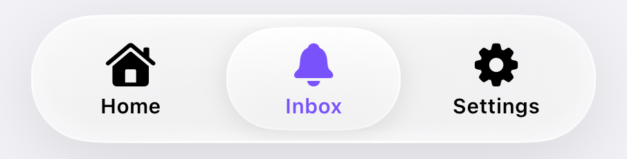
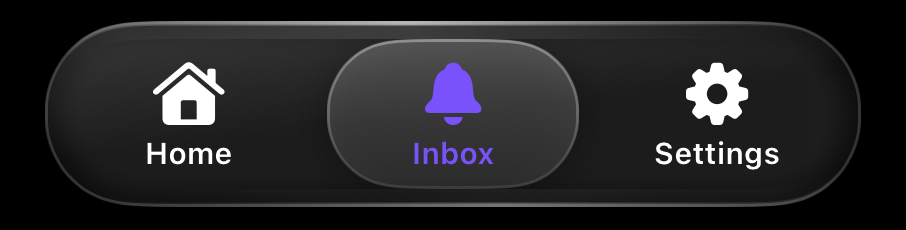
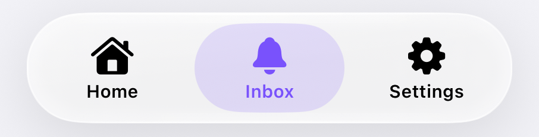
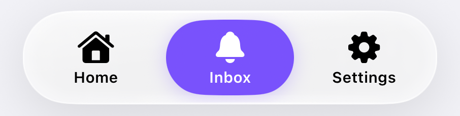
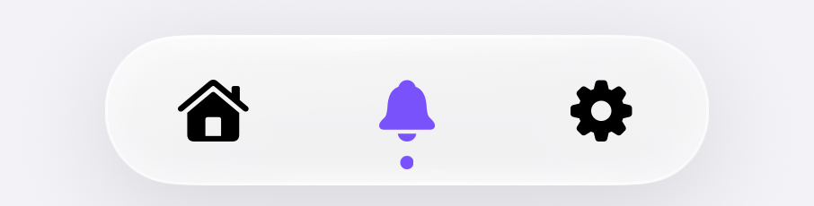
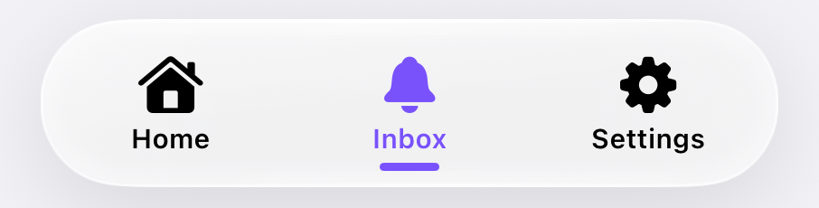

# LiquidGlassKit

**iOS 26 Liquid Glass on iOS 17 and 18.** A drop-in tab bar and a reusable glass view.
No dependencies, public UIKit API only, about 130 KB.

<table>
  <tr>
    <td align="center"><br/><sub><code>.default</code> · raised glass pill</sub></td>
    <td align="center"><br/><sub>dark mode</sub></td>
  </tr>
  <tr>
    <td align="center"><br/><sub><code>.tinted</code></sub></td>
    <td align="center"><br/><sub><code>.solid</code></sub></td>
  </tr>
  <tr>
    <td align="center"><br/><sub><code>.minimal</code> · icons + dot</sub></td>
    <td align="center"><br/><sub><code>.underline</code></sub></td>
  </tr>
</table>

## What you get

| iOS 26 effect | LiquidGlassKit |
|---|---|
| Glass refracts the content at its edge | Rim magnifies a live snapshot of what is behind |
| Rim light moves when you tilt the phone | CoreMotion, 30 Hz, only while visible, no permission |
| Light glass over light content, dark over dark | Brightness of the content behind, with hysteresis |
| Bar swells and glows under the finger | Spring + radial light that follows the finger |
| Press and slide across tabs: a glass droplet lifts, magnifies the icons, stretches with speed, lands with a spring | Same, plus selection haptics |
| Bar minimizes while scrolling (optional) | `minimizeBehavior`: `.never` (default), `.onScrollDown`, `.onScrollUp` |

On iOS 26 the controller keeps the system tab bar (already Liquid Glass) unless
you ask for the custom one.

## Install

Swift Package Manager: add this folder (or its repository) as a package dependency
and link the `LiquidGlassKit` product. iOS 17+.

```swift
.package(path: "../Packages/LiquidGlassKit")   // local
```

## Quick start

```swift
import LiquidGlassKit

let tabs = LiquidGlassTabBarController()            // glass on iOS 17–18, system bar on 26
tabs.viewControllers = [homeNav, inboxNav, settingsNav]
tabs.tabBar.tintColor = .systemPurple                // accent color
window.rootViewController = tabs
```

It is a real `UITabBarController`: `selectedIndex`, `delegate`
(`shouldSelect`/`didSelect`), `tabBarItem` title, image, `selectedImage` and
`badgeValue` (updated live), and tap-to-pop-to-root all work as usual.
Screens scroll under the glass and keep their last row above it.

If your tabs are navigation controllers with their own delegate, call
`tabs.contentWillChange()` from `navigationController(_:willShow:animated:)`
so the glass follows pushes.

## Customize

Everything is in one value. Start from a preset, change what you need:

```swift
tabs.appearance = .tinted                                  // a preset

tabs.appearance = .default.with {                          // or your own
    $0.selection.style = .solid
    $0.selection.color = .systemOrange
    $0.item.showsTitles = false
    $0.bar.itemWidth = 72
    $0.droplet.magnification = 1.3
}
```

Assigning `appearance` applies at once (wrap it in `UIView.animate` to animate).

| Group | Options |
|---|---|
| `bar` | `height`, `itemWidth`, `fillsWidth`, `horizontalMargin`, `bottomSpacing`, `contentInset`, `cornerRadius`, `minimizedSize` |
| `glass` | `effects` (refraction, specular, motion, adaptive), `tint`, `isClear`, `refraction`, `shadowOpacity` |
| `selection` | `style` (`.glass`, `.tint`, `.solid`, `.underline`, `.dot`, `.none`), `color`, `inset`, `cornerRadius`, `animation` (`.liquid`, `.spring`, `.none`), `bouncesIcon` |
| `item` | `iconPointSize`, `iconWeight`, `titleFont`, `showsTitles`, `spacing`, `selectedColor`, `normalColor`, `usesSelectedImage`, `badgeColor`, `badgeTextColor` |
| `droplet` | `isEnabled`, `magnification`, `lift`, `maxStretch` |
| (root) | `haptics` |

Presets: `.default`, `.tinted`, `.solid`, `.minimal`, `.underline`.

Other switches:

```swift
LiquidGlassTabBarController(style: .glass)      // custom bar on iOS 26 too
LiquidGlassTabBarController(style: .system)     // UIKit's bar everywhere
tabs.minimizeBehavior = .onScrollDown           // shrink while scrolling down (also sets iOS 26's tabBarMinimizeBehavior)
tabs.minimizeBehavior = .onScrollUp             // for content that grows upward (chats)
tabs.minimizeBehavior = .never                  // default: always full size, if your UX prefers
tabs.setMinimized(true, animated: true)         // or shrink/expand yourself (tabs.isMinimized)
tabs.setGlassBarHidden(true, animated: true)    // full-screen media
```

## Action button (camera, compose...)

A button in the bar that is not a tab: it runs your code (present the camera,
open a composer) instead of switching screens.

```swift
tabs.actionButton = LiquidGlassTabBarAction(
    image: UIImage(systemName: "camera.fill"),
    title: "Camera",            // VoiceOver
    placement: .center,         // .leading, .trailing, .index(n)
    style: .raised              // sticks out of the bar; .inline stays inside
) { tabs in
    tabs.present(CameraViewController(), animated: true)
}
```

The button sits in a glass **halo**, like the selection around a tab: it
swells and lights up under the finger, the icon squishes, and the rim light
and the circle (parallax) follow the tilt of the phone.

```swift
var camera = LiquidGlassTabBarAction(image: UIImage(systemName: "camera.fill"), title: "Camera") { ... }
camera.halo = .glass                          // default: frosted ring
camera.halo = .clear.padding(8)               // see-through, thicker
camera.halo = .glass.tint(.systemPurple)      // tinted ring
camera.halo = nil                             // just the circle
camera.followsMotion = false                  // no tilt effects (always off with Reduce Motion)
tabs.actionButton = camera
```

`.center` is the true center: with 3 tabs, one goes left and two right, each
half of the bar shared evenly. Options: `tint`, `iconColor`, `diameter`, `lift`,
`customView` (your own content). With `style: .system`, UIKit's bar cannot
hold it, so it floats above the bar; use `.glass` for the same look everywhere
(on iOS 26 the kit's bar is drawn with Apple's own glass).

## Bottom accessory (mini player)

```swift
tabs.accessoryView = MiniPlayerView()   // glass strip above the bar
tabs.accessoryHeight = 48
```

It moves next to the bar when the bar minimizes. With the iOS 26 system bar it
becomes a `UITabAccessory`.

## iOS 26: Apple's glass, automatically

Everything below calls Apple's real API on iOS 26 and the kit's drawing on
iOS 17–18. Your code is the same; no `#available`.

| Kit | iOS 26 |
|---|---|
| `LiquidGlassView` | `UIGlassEffect` (`usesSystemGlass = false` to keep the kit's look) |
| `.liquidGlass(_:in:)` | `glassEffect(_:in:)` |
| `.liquidGlassButton()` / `.liquidGlassButton(.prominent)` | `.buttonStyle(.glass)` / `.glassProminent` |
| `LiquidGlassContainer` + `.liquidGlassID` | `GlassEffectContainer` + `glassEffectID` |
| `.liquidScrollEdge()` | `scrollEdgeEffectStyle(.soft)` |
| `.liquidGlassSheet()` | system glass sheet |
| `.liquidGlassToggle()`, `LiquidGlassSlider`, `LiquidGlassSegmentedPicker` | system controls (already glass) |
| `minimizeBehavior`, `accessoryView` | `tabBarMinimizeBehavior`, `bottomAccessory` |

## SwiftUI components

```swift
Button("Buy") { }.liquidGlassButton(.prominent)
Text("Card").padding().liquidGlass(.regular.tint(.purple), in: .rect(cornerRadius: 24))

@Namespace var glass
LiquidGlassContainer(spacing: 12) {          // pieces flow into each other
    HStack {
        Button("Edit") { }.liquidGlassButton().liquidGlassID("edit", in: glass)
        if expanded { Button("Share") { }.liquidGlassButton().liquidGlassID("share", in: glass) }
    }
}

LiquidGlassSearchField(text: $query, prompt: "Search") { search() }
LiquidGlassToolbar {
    LiquidGlassToolbarButton("Share", systemImage: "square.and.arrow.up") { share() }
    LiquidGlassToolbarButton("Like", systemImage: "heart", isSelected: liked) { like() }
}
ScrollView { ... }.liquidScrollEdge()
.sheet(isPresented: $show) { Filters().liquidGlassSheet() }
```

Controls: the knob turns into a glass lens while you touch it (iOS 26 behavior).

```swift
Toggle("Reminders", isOn: $on).liquidGlassToggle()
LiquidGlassSlider(value: $volume, in: 0...1)
LiquidGlassSegmentedPicker(selection: $filter, segments: [.init("All", value: .all), .init("Music", value: .music)])
```

## Glass anywhere

```swift
let glass = LiquidGlassView()
glass.backdrop = contentView           // what is behind: refraction + adaptive color
glass.contentView.addSubview(button)
glass.cornerRadius = 20                // nil = capsule
glass.glassTint = .systemPurple        // tinted glass
glass.setPressed(true, at: point)      // swell + light under the finger
```


## Accessibility and performance

- VoiceOver: tab trait, selected state, badge read as value, double-tap selects.
  Long press shows the large content viewer, like the system bar.
- Reduce Transparency: solid bar, no lens. Reduce Motion: no stretch, swell or
  tilt. Increase Contrast: stronger rim.
- The lens follows the content only while it moves (scroll, push), about 1 ms
  per frame. Otherwise it checks once a second. Low Power Mode and a hot device
  drop it to 30 Hz.

## Honest limits

iOS 26 bends light per pixel inside the system compositor, which apps cannot
do. Here the rim magnifies a snapshot instead: it reads the same at normal
viewing distance, but it is an approximation.

## Tests

```bash
xcodebuild test -scheme LiquidGlassKit -destination 'platform=iOS Simulator,name=iPhone 16 Pro'
```

## Move it to its own repository

The folder is self-contained (`Package.swift`, sources, tests, docs). Copy it to
a new repository, add a `LICENSE`, tag a version (`1.0.0`), then replace the
local path with the URL in the app:

```swift
.package(url: "https://github.com/<you>/LiquidGlassKit.git", from: "1.0.0")
```
