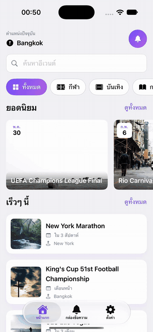
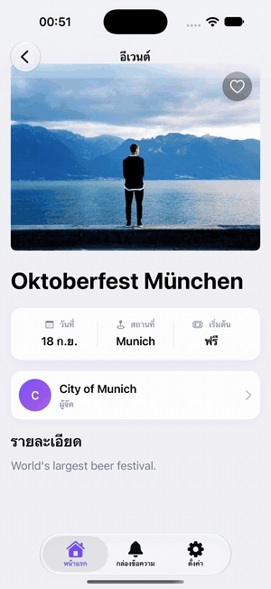
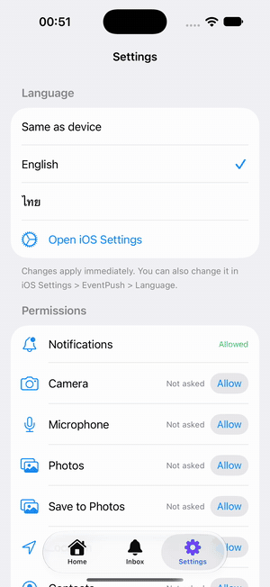
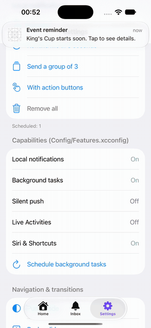
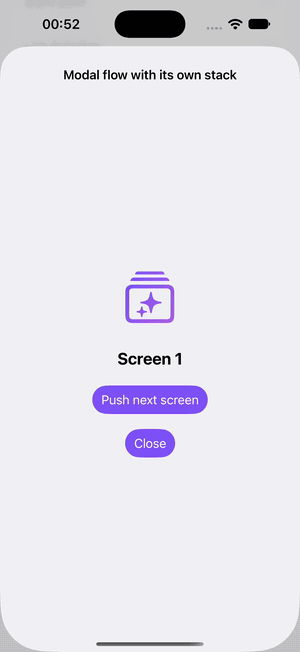

<div align="center">

# EventPush Starter Kit

**A production-grade native iOS app _and_ a template to start yours.**
SwiftUI **and** Storyboard side by side · modular by design · ready to grow into a super app.


</div>

<table>
  <tr>
    <td align="center"><br/><b>Navigation showcase</b><br/><sub>hero expand · push · sheet · flip</sub></td>
    <td align="center"><br/><b>Live language switch</b><br/><sub>Thai ⇄ English, no restart</sub></td>
    <td align="center"><br/><b>Permissions & notifications</b><br/><sub>every status, grouped, actions</sub></td>
  </tr>
  <tr>
    <td align="center"><br/><b>Transitions & modal flows</b><br/><sub>fade · slide · scale · sheet · own stack</sub></td>
    <td align="center"><br/><b>Animation kit</b><br/><sub>appear · shake · pop · shimmer · numbers</sub></td>
    <td align="left">
      <b>What you get</b><br/><br/>
      ✅ Clean layered modules (App · Features · Domain · Data · Platform)<br/>
      ✅ VIPER + Coordinators<br/>
      ✅ Deep links to any screen<br/>
      ✅ SwiftData, Keychain, encryption<br/>
      ✅ Notifications, background, Siri<br/>
      ✅ Live EN/TH localization<br/>
      ✅ iPhone & iPad adaptive layout<br/>
      ✅ 318 tests, 0 crash patterns<br/>
      ✅ <code>make feature</code> in 1 second
    </td>
  </tr>
</table>

---

## Why this kit

Most sample apps show *a screen*. This one shows **how a real team ships an app
for years**: clear boundaries, one way to do each thing, and tools that make the
right way the easy way.

| You want | You get |
|---|---|
| **Scale the codebase and the team** | One Swift package, one module per layer (App · Features · Domain · Data [DataLayer + DataSources] · Platform + Core, Navigation, DesignSystem), arrows checked on every build. Features are folders; no `Package.swift` edits to add one. Split a business area into its own module when it grows into a mini-app. |
| **SwiftUI _and_ UIKit** | Every screen can be SwiftUI or Storyboard, behind the same VIPER contract and the same coordinator. Mix them freely (the Inbox tab is a Storyboard screen). |
| **Start a feature fast** | `make feature NAME=Profile` → coordinator + screen + **passing tests** in one second. Xcode *File → New* templates too. |
| **Start a new app fast** | `make project NAME=ShopApp BUNDLE=com.acme.shop DEST=~/Projects` → renamed, configured, building, with git initialized. |
| **Never ship a crash** | `make lint` blocks `try!`, `as!`, force unwraps, `fatalError`, `unowned`. System APIs that can kill the app are guarded. MetricKit reports real crashes with no SDK. |
| **Stay small and fast** | ~1.5 MB download, 2 dependencies, everything statically linked, 0 embedded frameworks. |

## Feature tour

<details open>
<summary><b>🧭 Navigation & deep links</b></summary>

- **Coordinators** own flows; screens never navigate by themselves. Children are released automatically on pop, swipe-back or modal swipe-down — and **leak-checked**.
- **Navigator** API: `push`, `present` (sheet with detents, full screen, form sheet, over full screen), modal flows with their **own navigation stack**, `withoutAnimation` for deep links.
- **Transitions:** hero **expand** from a card (iOS 17+), fade, slide-up, scale, iOS 18 zoom, or your own animator (`.custom` — see the 3D flip). Swipe-back keeps working.
- **Liquid Glass on iOS 17+ ([LiquidGlassKit](Packages/LiquidGlassKit/README.md), its own package):** a tab bar with refraction, rim light that follows tilt, adaptive light/dark, a droplet you slide across tabs and a raised camera button; glass buttons, morphing containers, toolbar, search field, sheets, scroll edge, toggle/slider/segmented. On iOS 26 the same code calls Apple's real glass APIs. The tab bar look has 5 presets, switchable live in Settings → Tab bar.
- **Server-driven UI ([ServerDrivenUI](Packages/ServerDrivenUI/README.md)):** the backend (BFF) sends a screen as JSON, the app renders it with glass components and app-specific ones. Versioned schema, works offline (last good copy, bundled copy), opens from `eventpush://screens/<id>`.
- **Custom back button before iOS 26:** `.belowIOS26(.circle())` gives iOS 17–18 a round, iOS 26-like button and keeps Liquid Glass on iOS 26. Also chevron, tint, title or your own image, app-wide or per screen. Swipe-back, VoiceOver and the history menu still work.
- **Deep links to any depth**, custom scheme and universal links, relayed layer by layer:
  `eventpush://inbox/events/42/organizer` → Inbox tab → event 42 → organizer.
- Links from notifications, Siri or widgets wait in a `DeepLinkInbox` until the UI is ready (cold start safe).

</details>

<details>
<summary><b>🏗 Architecture</b></summary>

```
App              composition root · DI wiring · tabs · app routing · deep links
 │               (app target = AppDelegate + SceneDelegate + Siri intents only)
 ▼
Features         Presentation: Home · EventDetail · EventList · Notification · Settings
 │ business contracts only
 ▼
Domain           entities · use cases · repository protocols · domain errors (pure Swift)
 ▲ implements
Data             DataLayer: repositories · DTO + mapping · cache
                    ▼
                 DataSources: network (Alamofire) · SwiftData · Keychain · files · UserDefaults

Platform         notifications · push · background · permissions · Live Activities · crash · biometrics · analytics

Cross-cutting    Core (foundation · logging · concurrency · utilities · localization)
                 Navigation (navigator · coordinators · transitions) · DesignSystem
```

- **Rule:** a module imports only what its arrows allow — checked on every build (`scripts/check-layers.py`). Features never see Data or Platform.
- **Composition root:** `AppAssembly` plugs DataLayer implementations into Domain protocols at launch.
- **VIPER** per screen (Contract · Builder · View · Presenter · Interactor), `@Observable` presenters, `Loadable<T>` state.
- **In-house DI** (~100 lines, no library): every key has a safe default, overridable in tests.
- Alamofire lives only in `DataSources/Network`, Kingfisher only in `RemoteImage`: swap either by editing one file.

</details>

<details>
<summary><b>💾 Data & security</b></summary>

| Data | Store |
|---|---|
| Tokens, passwords, keys | **Keychain** (`ThisDeviceOnly`, optional Face ID) |
| Profile, PII, documents | **AES-GCM encrypted files** + Data Protection |
| Queryable data (favorites…) | **SwiftData** via `@ModelActor` repositories |
| Preferences, flags | **UserDefaults** |

One typed API (`store[.accessToken] = token`) for all of them. Plus SSL pinning,
reinstall wipe of secrets, jailbreak/debugger signals, app-switcher blur,
screenshot-proof views and expiring clipboard.

</details>

<details>
<summary><b>📱 System capabilities — on/off in one file</b></summary>

`Config/Features.xcconfig` turns each one on or off; **off means gone**: no
Info.plist keys, no entitlement, no app-target code, no runtime service.

- **Local notifications** — schedule, group, action buttons (incl. reply), remove by id / group / all, badges
- **Background tasks** — app refresh, processing, “finish after leaving the app”
- **Silent push** — APNs token + handlers by payload `type`
- **Live Activities** — start / update / end, widget template included
- **Siri, Shortcuts, Apple Intelligence** — App Intents that reuse deep links
- **Permissions** — notifications, camera, mic, photos, location, contacts, calendar, tracking; every status handled, never crashes on a missing purpose string
- **Crash & hang reports** — MetricKit, pluggable reporter
- **Analytics** — automatic screen views, typed business events, consent switch, personal-data filter, any SDK behind one adapter

</details>

<details>
<summary><b>🎨 UI kit</b></summary>

- Design tokens (spacing, radius, typography, colors) shared by SwiftUI and UIKit
- **Adaptive layout** for iPhone, iPad, split view and rotation (`compact / medium / expanded`)
- **Animation kit**: appear styles, stagger, shake, pop, pulse, shimmer, numeric text, transitions — all respect Reduce Motion
- **Keyboard toolkit**: tap-outside-to-dismiss app-wide, focus chains, Done bar, scroll avoidance (SwiftUI + UIKit)
- **Infinite scrolling** with `Paginator` (prefetch, retry, refresh, dedupe) and `LoadMoreFooter`
- **Live localization** EN/TH: switch in the app (instant) or in iOS Settings; dates and numbers follow

</details>

<details>
<summary><b>🤖 Bonus: the same Swift on Android</b></summary>


A working case study: event search, sorting, grouping and Thai/English
formatting written once in Swift, compiled with the official **Swift SDK for
Android**, and called from a **Kotlin + Jetpack Compose** app through JNI.

- ≈ 0.3 ms per query in Swift on the emulator (Release)
- Same `events.json` as the iOS app, shared logic tested with `swift test`
- Explicit memory ownership across the bridge (`AutoCloseable` handle)
- Measured size cost and every pitfall we hit, with fixes

`make android-run` · read [Swift on Android](docs/SWIFT_ANDROID.md)

<br clear="right"/>
</details>

## Quick start

```bash
git clone <this repo> && cd EventPushStarterKit-Api-SwiftUI-VIPER
open EventPushStarterKit.xcodeproj      # run the EventPushStarterKit scheme
```

Debug builds use bundled JSON (`USE_MOCK_API = YES`): the app runs offline.
Requires **Xcode 26+** (Swift 6.2+). Deployment target **iOS 17**.

## Everyday commands

```bash
make feature NAME=Profile                 # new feature (SwiftUI)  — UI=uikit for Storyboard
make scene FEATURE=Profile NAME=Edit      # new screen in a feature
make project NAME=ShopApp BUNDLE=com.acme.shop DEST=~/Projects
make templates                            # Xcode File > New > VIPER templates
make test        make coverage            # 318 tests · per-layer coverage
make lint        make size                # crash-safety + layer rules · app size report
make android-run                          # Swift-on-Android demo on the emulator
```

## Project map

```
App/            AppDelegate, SceneDelegate, App Intents, assets
Config/         xcconfig per build, feature flags, Info.plist, entitlements
Modules/        ONE Swift package, one module per layer
  Sources/App/             composition root, tab flows, app routing, adapters
  Sources/Features/        one folder per feature + Shared
  Sources/Domain/          entities, use cases, repository protocols
  Sources/Data/            group: DataLayer (repositories, DTOs, fixtures) + DataSources (network, database, Keychain, storage)
  Sources/Platform/        notifications, push, background, permissions, crash, biometrics, analytics
  Sources/Core/            DI, environment, logging, concurrency, utilities, localization
  Sources/Navigation/      navigator, coordinators, transitions
  Sources/DesignSystem/    tokens, components, animation, keyboard, layout
  Tests/                   one test target per module
Packages/       standalone packages, ready for their own repo
  LiquidGlassKit/          iOS 26 Liquid Glass for iOS 17+ (tab bar, components, controls), no dependencies
  ServerDrivenUI/          BFF screens as JSON, rendered with glass components
Android/        Swift on Android case study (Swift package + Kotlin/Compose app)
Templates/      Xcode + generator templates (feature, scene, project, extensions)
scripts/        generators, lint, coverage, size, strings, headers
docs/           the guides below
```

## Quality, measured

| | |
|---|---|
| Unit tests | **318** (app modules 255 + LiquidGlassKit 54 + ServerDrivenUI 9), Swift Testing, run in ~1 min |
| Logic coverage | **~90 %** (`make coverage`; system prompts / APNs / Keychain need a device) |
| Crash-prone patterns | **0** (`make lint`) |
| Memory | every coordinator flow has a release test; `LeakDetector` in Debug |
| Concurrency | Swift 6 language mode: data races are compile errors |
| App size | **~1.5 MB** download, ~3.8 MB installed (`make size`) |

## Guides

| Guide | Read it when you… |
|---|---|
| [Architecture](docs/ARCHITECTURE.md) | join the project — start here |
| [Conventions](docs/CONVENTIONS.md) | write code: naming, access control, memory, crash safety |
| [Navigation & deep links](docs/NAVIGATION.md) | add screens, transitions, modals, deep links |
| [UI & design system](docs/UI.md) | build screens: tokens, layout, animation, keyboard, paging |
| [Localization](docs/LOCALIZATION.md) | add texts or languages |
| [Data storage](docs/DATA_STORAGE.md) | save anything on the device |
| [Security](docs/SECURITY.md) | handle secrets and sensitive screens |
| [Capabilities](docs/CAPABILITIES.md) | notifications, background, push, Live Activities, Siri, permissions |
| [Analytics](docs/ANALYTICS.md) | track screens and events, add an SDK, handle consent |
| [Server-driven UI](docs/SERVER_DRIVEN_UI.md) | BFF screens: open, add a component, offline fallbacks |
| [Testing](docs/TESTING.md) | write tests, check coverage |
| [App size](docs/APP_SIZE.md) | add a dependency or assets |
| [Templates](docs/TEMPLATES.md) | create features, screens or a new app |
| [Swift on Android](docs/SWIFT_ANDROID.md) | want to share Swift business logic with an Android app |

<div align="center">
<sub>Built to be copied. Start your next iOS app from here.</sub>
</div>
