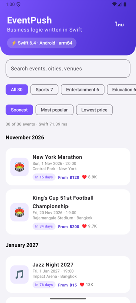
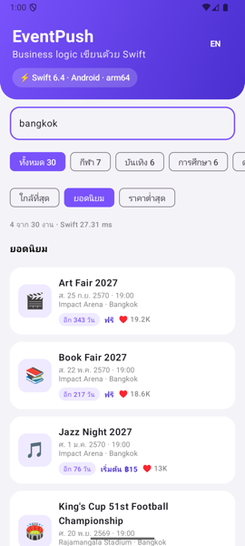
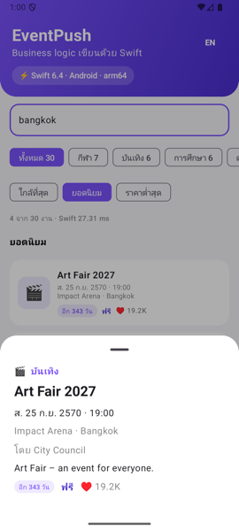

# Swift on Android (case study)

Can the business logic of this iOS app run, unchanged, inside a native Android
app? Yes. This folder is a working proof: event search, sorting, grouping and
Thai/English formatting are written once in Swift, compiled to an Android
native library, and called from a Kotlin + Jetpack Compose app.

<table>
  <tr>
    <td align="center"><br/><sub>List: sections, dates, prices, countdown<br/>all computed by Swift</sub></td>
    <td align="center"><br/><sub>Thai texts + Buddhist year<br/>from the same Swift code</sub></td>
    <td align="center"><br/><sub>Compose UI, Swift data</sub></td>
  </tr>
</table>

Running on the Android emulator (API 35, arm64), Release build:

| | |
|---|---|
| One query (search + sort + group + format + JSON, 30 events) | **≈ 0.3 ms** in Swift |
| Cold start (emulator) | ≈ 0.85 s |
| Swift library in the APK | 11.6 MB raw, **≈ 4.4 MB compressed** (see [Size](#size)) |
| Shared logic tests | run on the Mac with `swift test` |

## How it works

Swift is a compiled language built on LLVM. LLVM already knows how to produce
code for Android's CPUs, so the question is only about the *runtime*: the
Swift standard library and Foundation must exist for Android. Since Swift 6.3,
swift.org ships an official **Swift SDK for Android** with exactly that.

```
 Kotlin / Compose (UI)                       Swift (business logic)
 ─────────────────────                       ──────────────────────
 EventsModel ──► SwiftEventCatalog ──JNI──►  EventBridge (@_cdecl "Java_…")
                  (AutoCloseable)               │
                                                ▼
                                             EventShared: EventCatalog, EventFormatter
                                                │  pure Swift + FoundationEssentials
                                                ▼
 libEventBridge.so  =  your code + Swift runtime + FoundationEssentials (static)
 libc++_shared.so   =  C++ runtime from the Android NDK
```

1. **Compile.** `swift build --swift-sdk aarch64-unknown-linux-android28`
   cross-compiles on the Mac. The output is a normal Linux-style ELF shared
   library linked against Android's C library (Bionic), from the NDK.
2. **No Objective-C.** Android has no Objective-C runtime. Pure Swift works;
   `NSObject`, `@objc`, UIKit and SwiftUI do not exist there.
3. **Foundation.** The SDK contains the open-source Foundation. We import only
   `FoundationEssentials` (JSON, `Date`, `Data`), which avoids the ~30 MB ICU
   data that full `Foundation` needs.
4. **Call from Kotlin.** Java/Kotlin call native code through JNI.
   `System.loadLibrary("EventBridge")` loads the `.so`; each `external fun`
   is matched by name to a C symbol such as
   `Java_com_eventpush_android_SwiftBridge_query`, which Swift exports with
   `@_cdecl`.
5. **Exchange data.** Values cross the bridge as UTF-8 JSON in byte arrays.
   It is simple, debuggable and fast enough (the whole snapshot is < 1 ms).
6. **Own memory explicitly.** A Swift object is handed to Kotlin as an opaque
   `Long` (`Unmanaged.passRetained`). Kotlin wraps it in `AutoCloseable`;
   the ViewModel closes it in `onCleared()`, which releases the Swift object.
   Queries and `close()` are synchronized, so a running query can never use
   freed memory.

## Folder layout

```
Android/
  SwiftCore/                      Swift package (also builds and tests on the Mac)
    Sources/EventShared/          business logic: Event, EventCatalog, EventFormatter, CivilDate
    Sources/EventBridge/          JNI exports (Android only, #if os(Android))
    Sources/CJNI/                 tiny C helpers around <jni.h>
    Tests/EventSharedTests/       Swift Testing, runs with `swift test`
    .swift-version                toolchain pin for swiftly (6.4.1)
  app/                            Android app: Kotlin + Jetpack Compose
    src/main/java/.../SwiftBridge.kt   JNI declarations + SwiftEventCatalog + JSON models
    src/main/java/.../EventsModel.kt   ViewModel: UI state only
    src/main/java/.../EventsScreen.kt  Compose UI
  scripts/build-swift.sh          cross-compiles Swift, copies .so files into app/build
```

`events.json` is read from `Modules/Sources/Data/DataLayer/Resources/Fixtures`, the
same file the iOS app uses. There is one copy of the data and one copy of the
rules.

## Setup (once)

The Xcode toolchain cannot build for Android. Install the swift.org toolchain
next to Xcode. Your `swift` command and Xcode do not change.

```bash
# 1. swiftly (toolchain manager) + Swift 6.4.1
curl -O https://download.swift.org/swiftly/darwin/swiftly.pkg
installer -pkg swiftly.pkg -target CurrentUserHomeDirectory
~/.swiftly/bin/swiftly init --no-modify-profile --skip-install -y
~/.swiftly/bin/swiftly install 6.4.1

# 2. Swift SDK for Android (same version as the toolchain)
~/.swiftly/bin/swift sdk install \
  https://download.swift.org/swift-6.4.1-release/android-sdk/swift-6.4.1-RELEASE/swift-6.4.1-RELEASE_android.artifactbundle.tar.gz \
  --checksum a356b79f8f1daa6ae3a66f4c556966ca20c0208b3659805cf30a83a0a31d6772

# 3. Android NDK r30 (Android Studio > SDK Manager, or:)
sdkmanager --install "ndk;30.0.16248370"

# 4. Link the NDK into the Swift SDK
ANDROID_NDK_HOME=~/Library/Android/sdk/ndk/30.0.16248370 \
  bash ~/Library/org.swift.swiftpm/swift-sdks/swift-6.4.1-RELEASE_android.artifactbundle/swift-android/scripts/setup-android-sdk.sh
```

Also needed: Android Studio (for the JDK, SDK and an emulator).

## Build and run

```bash
make android-run        # build Swift + APK, install and launch on the running emulator/device
make android            # build the debug APK only
make android-test       # test the shared Swift logic on the Mac
```

Or open the `Android/` folder in Android Studio and press Run: Gradle runs
`scripts/build-swift.sh` before every build (`preBuild` depends on `buildSwift`).

Intel emulator? Build both ABIs: `ABIS="arm64-v8a x86_64"` and add `"x86_64"`
to `abiFilters` in `app/build.gradle.kts`.

## Size

Measured on arm64, stripped, Release:

| What is linked | `.so` size | Compressed (≈ download) |
|---|---|---|
| Swift runtime only (stdlib + concurrency + dispatch) | 5.2 MB | 1.9 MB |
| + FoundationEssentials (JSON, Date) — **this POC** | 11.6 MB | 4.4 MB |
| + full Foundation (ICU, internationalization) | ≈ 40 MB+ (estimate from the SDK's static libraries) | not worth it here |
| `libc++_shared.so` (NDK) | 1.4 MB | 0.5 MB |

What this means:

- The Swift runtime is a fixed cost of about 2 MB download per ABI, paid once
  however much Swift you add. Ship arm64 only (or use App Bundles, which
  deliver one ABI per device).
- Each Foundation module is a choice. `FoundationEssentials` costs about 2.5 MB
  download. To save it, decode JSON with a small hand-written parser or pass
  plain values over JNI.
- `-Osize` and `--gc-sections` changed almost nothing here; the runtime
  dominates.

## Problems we hit (and the fixes)

| Symptom | Cause | Fix |
|---|---|---|
| `swift build --swift-sdk …` fails with Xcode's `swift` | Apple's toolchain has no Android support | Use the swift.org toolchain (`~/.swiftly/bin/swift`, pinned by `.swift-version`) |
| `dlopen failed: cannot locate symbol "_dispatch_main_q"` | `--static-swift-stdlib` does not add libdispatch to *library* products | `linkerSettings: [.linkedLibrary("dispatch"), .linkedLibrary("BlocksRuntime")]` for Android |
| `cannot locate symbol "_ZNSt6__ndk113__hash_memoryEPKvm"` | NDK r27's `libc++_shared.so` is older than the C++ runtime Swift 6.4 was built with | Use NDK r30 for both the SDK setup and Gradle `ndkVersion` |
| (avoided by design) Emoji can abort the app under CheckJNI | `NewStringUTF` expects "modified UTF-8" | Pass UTF-8 bytes (`ByteArray`) and decode in Kotlin |
| (avoided by design) Crash if the screen closes during a query | Swift object freed while still in use | `synchronized` around query and `close()` |
| `Bundle.module` resources not found on Android | APK assets are not a file-system bundle | Kotlin reads assets and passes the bytes to Swift |
| Time zone names | No tz database in `FoundationEssentials` on Android | Kotlin passes its UTC offset; Swift does pure calendar math (`CivilDate`) |

## What to share, what not to share

Share (pure Swift, no UI): domain models, validation, business rules, search
and sorting, price and date formatting, API DTOs and mapping, state machines.

Keep native per platform: UI (SwiftUI/UIKit vs Compose), navigation,
notifications, permissions, storage APIs (Keychain vs Keystore), anything that
calls the operating system.

## Next steps

- **swift-java** (`jextract`, JNI mode) generates the Kotlin/Java wrappers and
  the `@_cdecl` glue from Swift declarations, replacing `EventBridge` and
  `SwiftBridge.kt` by generated code.
- **Use `EventShared` in the iOS app.** Add `Android/SwiftCore` as a local
  package to `Modules/Package.swift`, then have `Domain` use `EventCatalog` and
  `EventFormatter`. iOS and Android then run the same rules.
- Move the shared package out of `Android/` (for example `Shared/`) once both
  apps depend on it.

## Sources

- swift.org — Getting started with the Swift SDK for Android
- swift.org blog — Announcing the Swift SDK for Android; Exploring the Swift SDK for Android
- swift.org — GSoC 2025 showcase: swift-java JNI mode
- Swift Forums — Android workgroup threads (SDK 6.3 snapshots)
